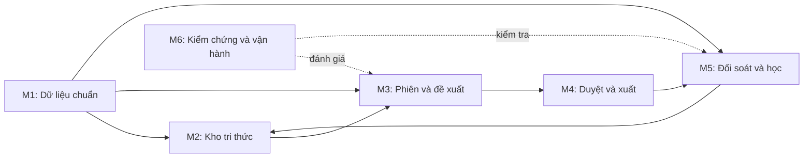

# Kế hoạch 6 module — phần mềm kho tri thức

Ngày 17/09/2026 · Bản đề xuất 1.1 · **6 module chính** để giao việc và nghiệm thu.

## 1. Đề xuất và phạm vi

Xây một ứng dụng Python chạy nội bộ, dùng SQLite và Excel, theo chu trình **đọc dữ liệu → đề xuất có bằng chứng → người duyệt → xuất Junsky → xác minh → học có điều kiện**.

Giữ phạm vi đã chốt trong `KE-HOACH-PHAN-MEM-KHO-TRI-THUC.md` bản 1.2: một pháp nhân PLHN; sao kê là đối tượng đề xuất; hóa đơn/Base là bằng chứng; Junsky chỉ qua import Excel; chưa xây UI, không API, không AI/ML/LLM trong sản phẩm; tri thức có phiên bản và kỳ hiệu lực; mỗi lần chạy có ba cổng.

**Hiện trạng đã kiểm tra:** thư mục chỉ có bản kế hoạch 1.2; chưa có script khảo sát, dữ liệu, từ điển hoặc mẫu Junsky được dẫn trong đó. “60% khối lượng đã có”, các tỷ lệ phủ/đúng là số liệu **tài liệu gốc báo cáo**, chưa được xác minh trong lần lập kế hoạch này.

Đây là kế hoạch đề xuất trước coding. Các sửa đổi tại mục 3 cần được ghi nhận khi Anh duyệt kiến trúc; không tự thay quyết định đã chốt.

## 2. Sáu module giao việc

| Mã | Module | Kết quả Anh nhận được | Phụ thuộc |
|---|---|---|---|
| **M1** | **Nền tảng và dữ liệu** | Đọc, chuẩn hóa, kiểm tra 5 nhóm nguồn vào SQLite; chống trùng, truy nguồn | Thiết kế được duyệt; mẫu từng nguồn |
| **M2** | **Kho tri thức** | Danh mục, chính sách, tình huống, thống kê và quy tắc có phiên bản; liên kết lịch sử | M1 |
| **M3** | **Phiên xử lý và máy đề xuất** | Cổng vào, công nợ/giữ chỗ; đề xuất sao kê có bằng chứng và tin cậy từng trường | M1, M2 |
| **M4** | **Duyệt và xuất Junsky** | Excel duyệt, quyết định có nhật ký, batch Junsky, chốt phiên và phục hồi | M3; mẫu import xác nhận |
| **M5** | **Đối soát và học liên tục** | Xác minh ghi sổ; nhãn đủ điều kiện; thống kê, quy tắc chờ duyệt | M2, M3; phần vận hành cần M4 |
| **M6** | **Kiểm chứng, báo cáo và vận hành** | Backtest A/B, kiểm tra mù, báo cáo, hướng dẫn, backup/restore, UAT | Bắt đầu với M1; hoàn thiện theo M1–M5 |

Đây là **sáu gói giao việc**, không phải sáu dịch vụ. Các hàm/gói Python nhỏ vẫn tách để dễ bảo trì; không biến thành thêm đầu việc quản lý cho Anh.

### M1 — Nền tảng và dữ liệu

**Công việc:** khung Python, cấu hình, SQLite/migration, audit; kiểu dữ liệu chuẩn hai cấp chứng từ/dòng; bọc script hiện có nếu được cung cấp. Đọc sao kê, XML hóa đơn, bảng kê hóa đơn, Base và Junsky xuất. Có staging, báo cáo lỗi, chống trùng, provenance và backup cơ bản.

**Đầu vào:** script cũ, mẫu từng định dạng, bộ xuất Junsky, hợp đồng cột/tổng kiểm soát.

**Đầu ra:** bộ đọc thống nhất; `kho.sqlite`; CLI nạp/kiểm tra; báo cáo file/dòng/tổng; fixture giả lập.

**Nghiệm thu:**

- File được chấp nhận qua kiểm tra tổng/phạm vi; file lỗi không nhập nửa chừng hoặc bỏ dòng im lặng.
- Nạp lại không trùng; hai giao dịch thật cùng ngày/tiền không bị gộp nhầm.
- Cùng hóa đơn trong XML và bảng kê là một thực thể, hai nguồn bằng chứng; lưu trạng thái điều chỉnh/thay thế khi có.
- Quét Base từ thư mục, đối chiếu chỉ mục; báo chênh số lượng và lỗi giải mã.
- Thiếu mẫu thì chỉ hoàn thành contract/fixture cho nguồn đó, chưa tuyên bố đọc được dữ liệu thực.

### M2 — Kho tri thức

**Công việc:** mô hình và truy vấn 5 nhóm: danh mục/định danh; chính sách/ràng buộc/mẫu; bộ nhớ tình huống; thống kê dẫn xuất; quy tắc/nhật ký. M5 chịu trách nhiệm tính thống kê và đề cử, dùng giao diện M2.

Liên kết lịch sử hóa đơn ↔ sổ trước, rồi sao kê ↔ sổ 112 ↔ công nợ; Base bổ sung bằng chứng. Gắn `LINK_A/B/C`, lý do, chứng cứ và thời điểm. Đo E2: mã giao dịch ngân hàng có xuất hiện trên sổ 112 không.

**Đầu ra:** tri thức từ Excel, truy vấn theo thời điểm, quản lý chờ duyệt; báo cáo liên kết và mẫu người kiểm.

**Nghiệm thu:**

- Khóa quản trị là mã đối tượng Junsky; MST/tài khoản/tên là định danh có mức xác minh.
- Thay đổi danh mục/quy tắc chưa duyệt không được áp dụng; không ghi đè lịch sử.
- Không âm thầm chọn giữa hai phiên bản xung đột; nhiều ứng viên không bị ép thành A.
- Base liên kết yếu không tự đủ làm nhãn học.
- Người kiểm A/B; báo cỡ mẫu, thu/chi, giá trị và phần không nối được.

### M3 — Phiên xử lý và máy đề xuất

**Công việc:** snapshot, cổng vào, một phiên hoạt động; công nợ mở, giữ chỗ/phân bổ nhiều–nhiều; nhận diện → đối chiếu → ràng buộc → xếp hạng → tin cậy.

**Đầu ra:** đề xuất đầy đủ/một phần/không, bằng chứng và tin cậy từng trường; số còn phân bổ. Baseline dùng 10–15 mẫu sao kê do kế toán trưởng duyệt.

**Nghiệm thu:**

- Kiểm tra phiên trước, pháp nhân, kỳ, `as_of`, danh mục, kỳ khóa; lý do từ chối rõ.
- Khóa và phân bổ trong transaction; không vượt tiền sao kê/số còn mở; retry không nhân đôi.
- Một khoản trả nhiều HĐ, nhiều khoản trả một HĐ, trả một phần, tiền chưa phân bổ đều có trạng thái rõ.
- Kiểm tra đã ghi sổ trước đề xuất; snapshot mới không thay kiểm tra chống nhập hai lần.
- Ràng buộc thắng điểm; định danh xác minh thắng từ khóa; thiếu dự án/khoản mục không đoán.
- Áp dụng TK theo hiệu lực; phí ngân hàng không bị buộc qua 131/331.
- Hoàn/đảo, bù trừ, thanh toán hộ chưa có mẫu duyệt phải vào ngoại lệ.

### M4 — Duyệt và xuất Junsky

**Công việc:** xuất/nhập Excel duyệt, sửa đổi có lý do; batch `CB_tmpEntry1/2` theo mẫu thật; công nợ kỳ vọng, chốt phiên, manifest và recovery. Pilot tắt duyệt nhanh theo lô.

**Đầu ra:** workbook duyệt; quyết định có phiên bản/người/thời điểm; batch Junsky; hướng dẫn nhập và phục hồi.

**Nghiệm thu:**

- Excel có ID phiên/đề xuất/phiên bản; file cũ, sai phiên, sửa khóa bị từ chối; không cập nhật một phần.
- Quyết định sửa phải chạy lại ràng buộc và kiểm tra số còn mở.
- Chỉ xuất bản duyệt cuối đủ trường; cân Nợ/Có, đúng cột/kiểu và quan hệ header–detail.
- Chưa xác nhận EntryID, DebtID, Entry2 thì chưa bật xuất vận hành; không tự bịa mapping.
- Batch có ID/checksum; thử lại giữ định danh nghiệp vụ, phát hiện batch chưa xác minh trước tái xuất. Không giả định Junsky tự chống trùng khi người nhập file lần hai.
- Lỗi giữa ghi file/DB phục hồi được; không báo đã xuất khi file hỏng.

### M5 — Đối soát và học liên tục

**Công việc:** so kỳ vọng với snapshot/chứng từ mới; `RECON_A/B/C`; xác minh từng trường; nhãn; thống kê theo số lượng lẫn giá trị; đề cử quy tắc kèm tác động và duyệt thủ công.

**Đầu ra:** đối soát, mục chưa xác minh, nhãn hiệu lực, thống kê theo kỳ, đề cử vào CHỜ DUYỆT.

**Nghiệm thu:**

- Công nợ giảm/HĐ đóng chỉ chứng minh biến động số dư; chưa đủ xác nhận đúng bút toán/TK/dự án.
- Chênh chưa rõ nguyên nhân giữ trạng thái chưa xác minh, không ép kết luận A/B/C.
- Bút toán ngoài hệ thống là ứng viên nhãn, cần chứng từ và kiểm tra độc lập.
- Mỗi chứng từ một nhãn hiệu lực; thu hồi/thay thế rồi tính lại, không trừ bộ đếm thủ công.
- Chỉ học trường đủ bằng chứng; nhãn chỉ duyệt/đã xuất không đủ. Nhãn lịch sử có quy trình xác minh riêng.
- Chạy lại không cộng lặp; không học chéo mốc hiệu lực; đề cử không tự kích hoạt.

**Nhịp thực hiện:** làm thống kê từ nhãn lịch sử đã xác minh để thử Baseline B trước. Sau M4, hoàn thiện đối soát hai phiên và vòng học vận hành. Vẫn dùng một prompt M5 để cập nhật phần còn lại.

### M6 — Kiểm chứng, báo cáo và vận hành

**Công việc:** fixture/test xuyên suốt; backtest point-in-time, Baseline A/B, kiểm tra mù; báo cáo; CLI; hướng dẫn kế toán/IT; backup/restore và UAT.

**Đầu ra:** báo cáo chất lượng/vận hành; tập vàng có phiên bản; hướng dẫn chạy/phục hồi; bộ nghiệm thu.

**Nghiệm thu:**

- Backtest không thấy dữ liệu/tri thức/nhãn tương lai; đáp án chỉ dùng ở bước chấm.
- Đo đúng toàn bộ, từng trường, phủ và phân bổ theo thu/chi, số lượng và giá trị tuyệt đối.
- Tách tập phát triển, holdout và kiểm tra mù; chấp nhận không đồng nghĩa đúng.
- Demo hai phiên, import một phần, sai HĐ cùng tiền, file cũ, ghi tay Junsky, lỗi giữa xuất.
- Khóa tháng sau đối soát cuối, không còn chênh/mục chưa xác minh/batch chờ thuộc phạm vi khóa.
- Restore thử thành công; kế toán hiểu thao tác; người được chỉ định xác nhận UAT.

## 3. Những chỉnh sửa thiết kế cần chốt

| ID | Điểm cần xử lý | Đề xuất | Trước phần nào |
|---|---|---|---|
| D01 | Bản 1.2 suy ra “đã nhập” từ HĐ đóng | Đối chiếu chứng từ/bút toán; thiếu bằng chứng thì chưa học | M5 |
| D02 | Hash khác không chứng minh bản mới nhất | Kiểm tra kỳ, phạm vi, as_of, thời điểm xuất, hash và tổng; dữ liệu không đổi có lý do | M1/M3 |
| D03 | Gói 5 file không đủ xác minh phí NH/lãi vay hoặc TK/dự án | Đề nghị thêm sổ 112/NKC/danh sách chứng từ có ID dòng; cần xác nhận khả năng xuất | M1/M5 |
| D04 | Số chứng từ/số HĐ đơn lẻ không luôn duy nhất | ID nội bộ + khóa nguồn tổng hợp pháp nhân, hệ nguồn, năm/loại/số, dòng; khóa HĐ gồm MST bán, ký hiệu, số và bối cảnh cần thiết | M1 |
| D05 | YAML ngoài danh sách thư viện chốt | Đề xuất TOML + tomllib của Python 3.11+; giữ YAML thì duyệt thêm PyYAML | M1 |
| D06 | Snapshot mới có thể chứa khoản sao kê đang xử lý | Kiểm tra đã ghi sổ và allocations xuyên phiên; giao dịch nghi vấn không tự xuất | M3 |
| D07 | Copy DB đang ghi có rủi ro; file/DB không chung transaction | SQLite backup API hoặc đóng DB trước copy; batch xuất có manifest/trạng thái/recovery | M1/M4 |
| D08 | Xuất cuối tháng chưa đồng nghĩa đối soát xong | Phiên chỉ đối soát sau nhập; giải thích chênh không biến chênh thành 0 | M5/M6 |
| D09 | Chưa tách ngày nghiệp vụ và ngày biết thông tin | Lưu known_at, ngày nghiệp vụ, hiệu lực, ngày duyệt/xác minh; replay theo cutoff | M1/M2/M6 |
| D10 | Khóa nội bộ không ngăn người ghi tay Junsky | Chốt cửa sổ vận hành hoặc xuất lại kiểm tra nếu có ghi tay; không hứa khóa được Junsky | M3/M4 |

Còn thiếu định nghĩa **3 chỉ số bằng chứng từ khóa, 7 mã lý do, 6 phần báo cáo kỳ**: lấy đúng bộ hiện có; chưa có thì ghi thiếu, không tự tuyên bố bộ mới là bộ đã chốt.

Ngưỡng kế toán/thuế và nội dung TT99 trong bản gốc cần kế toán trưởng xác nhận; tài liệu này không kiểm chứng pháp lý. Code chỉ áp dụng chính sách đã duyệt, có phiên bản/ngày hiệu lực.

## 4. Kiến trúc và hợp đồng tối thiểu

Giữ một ứng dụng, một SQLite; các gói nhỏ là cấu trúc code:

```text
src/kho_tri_thuc/
  ha_tang/      cấu hình, tiền/thời gian, DB, audit, backup       [M1]
  nguon/        5 nhóm bộ đọc                                   [M1]
  tri_thuc/     5 nhóm tri thức và liên kết                      [M2, M5]
  trang_thai/   phiên, snapshot, công nợ, phân bổ, đối soát      [M3, M5]
  de_xuat/      5 bước đề xuất                                 [M3]
  xuat/         Excel duyệt, Junsky, báo cáo                    [M4, M6]
  hoc/          nhãn, thống kê, đề cử, backtest, kiểm tra mù     [M5, M6]
  cli.py        điều phối, không chứa logic kế toán
tests/          fixture giả lập và test hành vi
docs/           hợp đồng, quyết định, tiến độ, nghiệm thu
```



| Hợp đồng | Nội dung bắt buộc |
|---|---|
| Batch nguồn | Pháp nhân, nguồn, hash, kỳ, as_of, exported_at, known_at, parser version, số dòng/tổng, trạng thái kiểm tra |
| Chứng từ/dòng | ID nội bộ, khóa nguồn, ngày, tiền/tiền tệ, tham chiếu file/trang/sheet/dòng, bản gốc |
| Tri thức | Giá trị, hiệu lực [từ, đến), thời điểm biết/duyệt, người duyệt, chứng cứ |
| Đề xuất | ID sao kê, phiên bản tri thức, giá trị/tin cậy từng trường, chứng cứ, ràng buộc/cảnh báo |
| Phân bổ | Sao kê × công nợ × tiền × phiên × trạng thái; tiền giữ/duyệt/ghi sổ/hủy |
| Quyết định | ID đề xuất/phiên/phiên bản, trường sửa, lý do, người/thời điểm |
| Batch xuất | ID batch/dòng, mapping version, manifest/checksum, trạng thái/recovery |
| Xác minh/nhãn | Liên kết chứng từ, trường xác minh, phương pháp/thời điểm, trạng thái/nhãn thay thế |

**Bất biến:**

- Tiền dùng Decimal khi tính, số nguyên theo đơn vị tiền nhỏ nhất khi lưu; không float trong đối chiếu. Chốt VND/ngoại tệ; không tự quy đổi.
- MST, số HĐ, mã, tài khoản là chuỗi giữ số 0 đầu.
- Một hàm chuẩn hóa: Đ/đ → D/d → NFD → bỏ dấu → viết hoa → gộp khoảng trắng; giữ văn bản gốc.
- DB có khóa ngoại, migration và transaction; raw bất biến, staging riêng.
- Không cộng lặp tiền khi tách dòng; không để chênh trái dấu che sai từng HĐ.
- LINK_A/B/C và RECON_A/B/C là hai loại mã; điểm xếp hạng chưa phải xác suất đúng.
- Runtime offline; thư viện chuẩn + pandas, openpyxl, lxml, pdfplumber; test ưu tiên unittest. Không thêm framework/server khi chưa cần.

## 5. Thứ tự làm và các cổng

### Bước 0 — chốt trước coding

Dùng **P0** để kiểm kê, trình phạm vi/hợp đồng và D01–D10. Anh duyệt rồi giao prompt module; không cần xin lại thao tác thường lệ trong phạm vi đã duyệt.

### Giai đoạn 0 — kiểm chứng khả thi

**M1 → M2 → M3 → M6 đo Baseline A → M5 thống kê lịch sử → M6 so Baseline B.**

Chưa cần hoàn chỉnh Excel duyệt/xuất để biết nguồn có đủ và thống kê có ích. M3 được thử bằng quyết định giả lập, không dùng chúng làm nghiệm thu dữ liệu thực.

**G0:** nguồn qua kiểm tra tổng; LINK_A được người kiểm (gợi ý gốc 98%, cần Anh chốt); A dưới 50% dòng sao kê thì rà nguồn; công nợ lịch sử được đối chiếu với từng chênh định danh/xử lý hoặc giải trình; có Baseline A/B và phần dư. Giải trình không đồng nghĩa chênh bằng 0.

B chỉ được chọn khi tăng độ phủ mà giữ chuẩn độ đúng/rủi ro đã duyệt. B chưa đạt thì có thể pilot bằng A, không cố bật học chỉ vì đã code.

### Giai đoạn 1 — hoàn thiện và chạy ngầm

Làm **M4**, hoàn thiện đối soát/vòng học vận hành của **M5**, dùng **M6** kiểm tra hai phiên và kiểm tra mù. Chạy theo nhịp có snapshot; file shadow không dùng nhập thật.

**G1:** chỉ định E5; kiểm tra theo lịch (gợi ý gốc 50 chứng từ/tuần); lỗi chặn đã xử lý; ngưỡng độ đúng, phủ và rủi ro theo tiền được duyệt. Không suy độ đúng từ tỷ lệ chấp nhận.

### Giai đoạn 2 — pilot vận hành

M6 hoàn thiện hướng dẫn/UAT; mở vận hành sau G1. Kế toán duyệt từng chứng từ.

**G2:** hai phiên hoàn chỉnh có chứng cứ ghi sổ/đối soát; không nhập trùng; xử lý được import một phần; restore thử; có người mở/duyệt/chốt/kiểm tra. Khóa tháng cần đối soát cuối, không batch chờ/mục chưa xác minh thuộc kỳ.

### Sau pilot

Hóa đơn theo dòng, Base thành nguồn đề xuất, pháp nhân thứ hai cần kế hoạch riêng sau G2, không thuộc sáu prompt pilot.

**Thời gian:** bản gốc ước 4–6 + 6–8 + 4 = 14–18 tuần, chưa được thẩm định ở đây. Giảm đầu mục quản lý không giảm tương ứng khối lượng nghiệp vụ. Ước lượng lại sau kiểm kê script và thử bộ đọc; coding nhanh không thay thời gian lấy dữ liệu/chạy chu kỳ sổ.

## 6. Đo chất lượng và nghiệm thu

| Chỉ số | Cách đo |
|---|---|
| Đúng toàn bộ | Đúng tất cả trường bắt buộc trên tập có đáp án độc lập; công bố mẫu số/phần chưa xác minh |
| Đúng từng trường | Đối tượng, TK, HĐ, tiền, dự án, khoản mục; chỉ chấm trường có ground truth |
| Độ phủ | Đầy đủ/một phần/không trên giao dịch hợp lệ trong phạm vi; nêu dòng bị loại |
| Phân bổ | Đúng HĐ và tiền; tách nhiều HĐ/trả một phần/thu/chi |
| Theo giá trị | Tổng trị tuyệt đối tiền giao dịch sai / tổng trị tuyệt đối tiền được đánh giá; mỗi giao dịch tính một lần |
| Liên kết | LINK_A/B/C, không nối được, cỡ mẫu, độ đúng người kiểm, thu/chi/nhóm giá trị |
| Thiên lệch duyệt | Chấp nhận so với kiểm tra mù trên mẫu/định nghĩa tương thích |
| Vận hành | Chênh, chưa xác minh, trùng bị chặn, thời gian kế toán, khả năng phục hồi |

Tập vàng 200–300 chứng từ theo bản gốc có phiên bản/người kiểm. Giữ riêng holdout và mẫu kiểm tra mù. “9 tháng học, 3 tháng thử” xét cả known_at và lúc nhãn đủ điều kiện. Không biết thời điểm dữ liệu có sẵn thì công bố backtest hồi cứu có giả định, không chứng nhận point-in-time tuyệt đối.

Mỗi module báo: thay đổi, file, test thực chạy/kết quả, demo, thiếu gì. `docs/TIEN-DO.md` có đúng **6 dòng module**, phân biệt: code với fixture; tích hợp mẫu thực; kế toán nghiệm thu; được phép vận hành. Không gộp thành một trạng thái hoàn thành.

Anh duyệt phạm vi/ngưỡng; kế toán trưởng duyệt nghiệp vụ; IT/Codex code/test/phục hồi; người kiểm tra mù lập đáp án độc lập.

## 7. Cách dùng bộ prompt

1. Dùng P0 trong `BO-PROMPT-CODEX.md` để thống nhất trước coding.
2. Sau khi duyệt, giao từng prompt M1–M6 theo nhịp mục 5; không giao toàn bộ cùng lúc.
3. M5/M6 quay lại nhiều giai đoạn nhưng vẫn là một module/một prompt chính, dựa trên tiến độ đã lưu.
4. Dùng R0 review ở mỗi cổng; review kỹ thuật không thay nghiệm thu kế toán.
5. Đối chiếu đầu vào trong `DU-LIEU-VA-QUYET-DINH-CAN-CHOT.md`.

Giữ nguyên bản 1.2 làm nguồn. Không AI áp dụng cho runtime; Codex hỗ trợ viết code. Mẫu cho Codex đọc/gỡ lỗi dùng fixture hoặc bản đã ẩn thông tin theo quy định nội bộ; không đưa dữ liệu thật vào prompt/công cụ ngoài.

